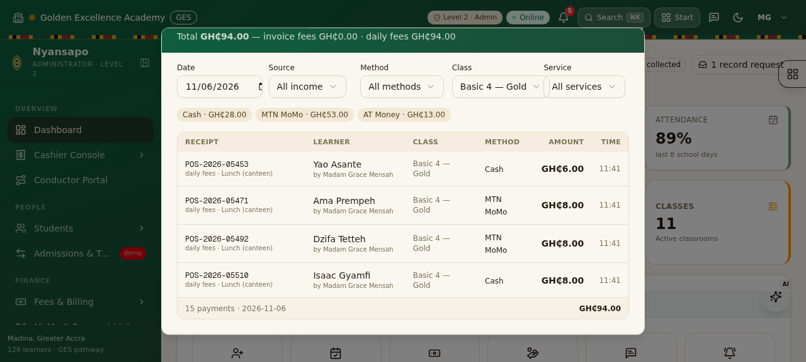
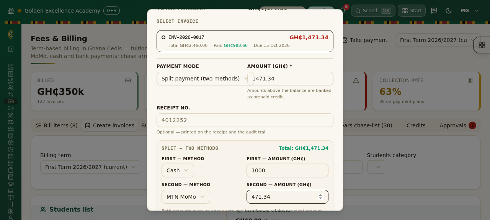
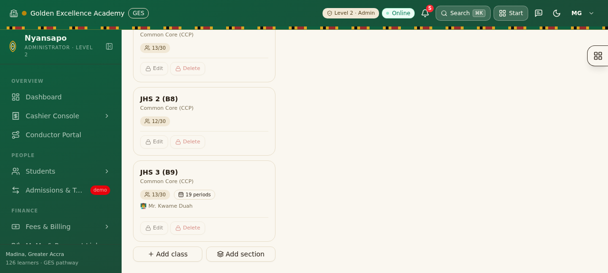
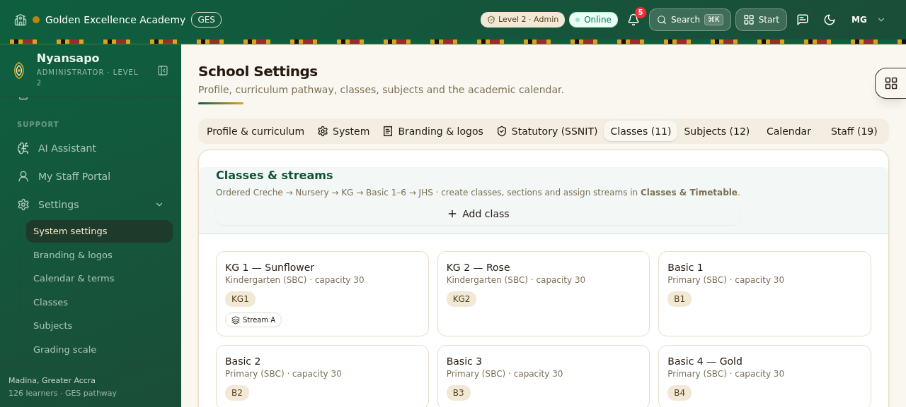
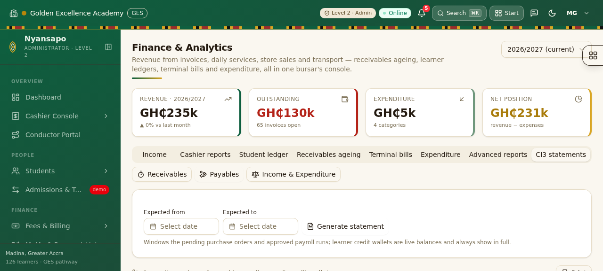
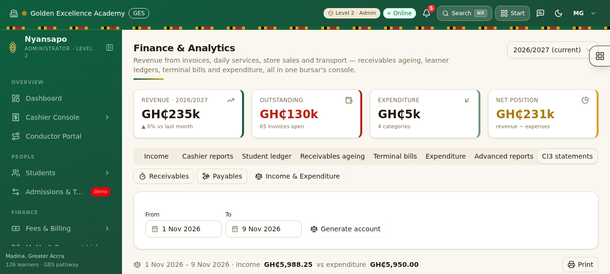
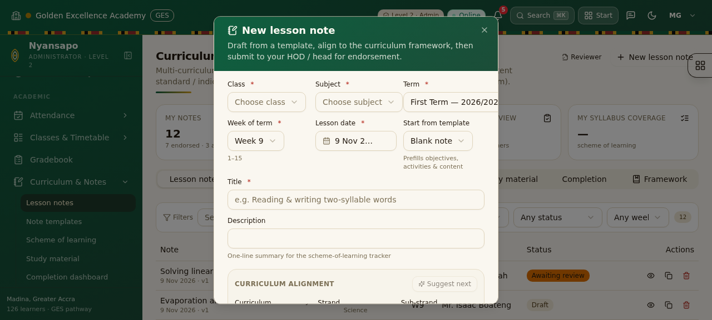

# Wave 11 — sections, CI3 financial statements, take-payment parity, per-event SMS, owner AI assistant

Fresh-session record: restored from origin (7e413df), reseeded, 23/23 smoke suites green.

## 1. Schema (`prisma/schema.prisma`)
- **Section** model — ordered streams within a classroom (`@@unique([classroomId, name])`), `Enrollment.sectionId?` links placements; `SmsSetting` gains 8 per-event toggles (`evtInvoicePaid`, `evtDailyFeesPaid`, `evtLearnerBilled`, `evtLearnerPresent` (default off), `evtLearnerAbsent`, `evtResultsPublished`, `evtPaymentReceipt`, `evtOverpaymentCredit`); `LessonNote` gains `strandCode/strandName/subStrandCode/subStrandName` — iEduPro ln-code/ln-name duality, separate from framework alignment.

## 2. Ordered class lists everywhere (CI3 `getFullClassList`)
- `src/lib/classes.ts`: `sortClassrooms()` ports the CI3 ladder — Creche → Nursery → KG → Basic 1–6 → JHS (B7–B9), numeric within stage; international tracks (EYFS/Y/PYP/MYP/DP) follow in their own ladders; name-hint fallback.
- Applied at every `db.classroom.findMany` site (15 API routes) + `app-shell` sidebar level groups — dropdowns, cards, class lists can never mix orders.

## 3. Settings › Classes — sections & guards
- `ops/classes` GET returns `sections[]` + `recordCount` (enrolments, fee structures, marks, attendance, timetable, exams, notes…). POST: `save-section` / `delete-section`.
- `classes.tsx`: class cards get **Edit + Delete** (both disabled + 🔒 when `recordCount > 0`); each section renders as a sub-card (“Basic 4 — Gold”) with its own guarded Edit/Delete (locked while learners are placed). Section dialog: name / sort order / capacity / note.
- `settings.tsx` Classes tab shows section chips + the ordering note; settings GET carries sections.

## 4. Fees PayDialog — CI3 `modal_take_payment.php` parity
- Learner search **right on the modal** (debounced, owes-first rows: NAME · index · class · OWES), click → STUDENT'S DETAILS grid + credit widget + open-invoice radio list (oldest first). CI3 field order: PAYMENT MODE / AMOUNT / RECEIPT NO. / conditional MoMo txn-id + cheque bank/no. **SPLIT payment mode**: two method+amount legs with live `Total: GH₵x of GH₵y`, sequential record-payment posts, partial-failure toasts. PRINT RECEIPT switch feeds the existing receipt dialog. Offline queueing preserved.

## 5. Financial reports (CI3 statements)
- `ops/finance` GET `receivables` (per-learner + aging 0/1–30/31–60/61–90/90+ + class sub-totals + grand total + CSV), `payables` (pending POs by supplier, APPROVED-unpaid payroll nets, learner credit balances), `income-expenditure` (lettered income sections with per-method/per-service sub-totals, expenditure categories, TOTAL rows, **SURPLUS/(DEFICIT)**).
- `finance.tsx` "CI3 statements" tab (deep-linked); `reports.tsx` "Financial statements" quick cards.

## 6. Dashboard — today's money
- **Income received today** card (all payments, fees + daily split, count) → CI3 `modal_daily_revenue` breakdown modal: date picker, source/method/class/service filters, split-aware method chips, full payment list. `ops/overview` serves `incomeToday`, `dailyTodayByMethod` and `?action=payments`.
- Daily-fee cards show per-method mini-breakdown; click opens the modal pre-filtered to that service.

## 7. Lesson notes — strand register + AI
- Separate code/name inputs (auto-filled from framework pickers, editable), shown on list rows, review queue and the print header; persisted via `ops/curriculum`.
- AI (via `/api/ai/[task]`): `lesson-note-generate`, `lesson-note-refine` (saves), `curriculum-suggest` (next strand/indicators); UI buttons "AI draft", "AI refine", "Suggest next" with spinners + graceful failure.

## 8. SMS per-event toggles
- `sms-center` Settings → "Per-event notifications" (8 switches, LEARNER_PRESENT flagged high-volume). `lib/sms.ts` `smsEventEnabled()` gates every trigger site: record-payment receipt + INVOICE_PAID + OVERPAYMENT_CREDIT, generate-invoices LEARNER_BILLED, attendance ABSENT + PRESENT, daily-fee receipts (counter + offline flush), sync flush. `save-settings` preserves absent keys (legacy callers can't wipe toggles).

## 9. Owner AI assistant
- `owner-assistant.tsx` floating chat (typed + Web Speech voice input, quick questions, finance chips) on the dashboard; `/ops/assistant` parses date intent deterministically (today/yesterday/weeks/months/terms/DD Month YYYY/ranges…), pulls real Payment/DailyCharge/StudentCredit/Expense figures, grounds the LLM, deterministic fallback if the LLM is down.

## 10–11. Verification passes
- Report sheets: CI3 template mapping confirmed; fixes — `WaecStatement` print-sheet pagination, ModernSheet null guards, `break-inside-avoid` on all sheet roots/rows (CI3 `.page-container` parity).
- Accounting recheck: full invariant audit (paid≤cap, status⇔amounts, Σpayments vs paidCents under credit semantics, DailyCharge paymentId links, StudentCredit balanceAfter). **4 API bugs fixed**: `apply-to-invoice` now banks over-paid excess as credit; `modreq.decide` EDIT uses ledger-aware `resyncPaidCents` (payments − banked excess + applied credits, clamped); DELETE subtracts only the attributable portion + reverses the banked credit (append-only ADJUST row); `invoiceStatus` can return OVERDUE.

## Ops notes
- Portable PostgreSQL 16 on 127.0.0.1:5433 (`.zscripts/pg-start.sh`) — distro PG is gone from the sandbox image.
- `scripts/cleanup-daily-sync.ts` — residue cleaner + receipt-counter self-heal for crashed daily-sync runs.
- `eslint.config.mjs` ignores `scripts/ci3app/**` reference code.

Verification: browser-verified every feature (screenshots below), zero console/page errors, **23/23 smoke suites green** (incl. daily-sync 40/40 after the save-settings fix).

